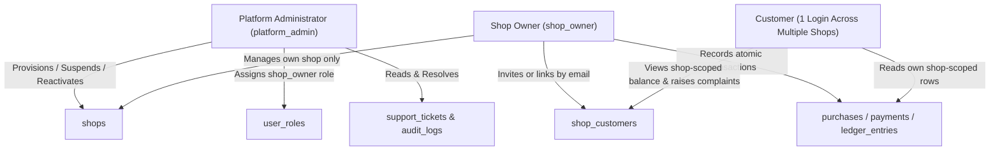

# ShopLedger SaaS — System Architecture

## 1. Platform Overview

**ShopLedger** (*"Credit, with clarity."*) is a multi-tenant Shop Credit & Debt Management SaaS platform built for neighbourhood grocery, hardware, and general provision shops and their credit customers.

The platform comprises three strictly separated role-based application experiences connected to a single **Supabase PostgreSQL** database and shared financial ledger engine:

1. **Platform Admin Web Dashboard (`apps/admin`)** — Next.js 15 App Router + TypeScript + Tailwind CSS.
2. **Shop Owner Mobile Application (`apps/mobile/(owner)`)** — React Native + Expo + Expo Router.
3. **Customer Mobile Application (`apps/mobile/(customer)`)** — React Native + Expo + Expo Router.

---

## 2. Monorepo Structure

```text
shopledger/
├── apps/
│   ├── admin/                # Next.js App Router Platform Admin Web Dashboard (A01–A22 + Edit Shop + Mobile Simulator)
│   └── mobile/               # React Native + Expo Mobile Application (Owner O01–O53 & Customer C01–C39)
├── packages/
│   └── shared/               # Shared TypeScript types, Zod schemas, Figma tokens & exact-decimal Ledger Engine
├── supabase/
│   ├── migrations/           # PostgreSQL DDL, Transactional RPCs, Immutability Triggers & RLS Policies
│   ├── functions/            # Deno Edge Functions (admin-create-shop, owner-invite-customer, generate-statement)
│   ├── seed.sql              # Multi-tenant seed dataset matching Figma screens
│   └── config.toml           # Supabase local development config
└── docs/
    ├── architecture.md
    ├── database.md
    ├── api.md
    └── development-plan.md
```

---

## 3. Multi-Tenant & Role-Based Security Model



### Key Architectural Invariants
- **Single Backend & Database**: Both `apps/admin` and `apps/mobile` connect to the same Supabase PostgreSQL instance and share `@shopledger/shared`.
- **No Public Admin or Customer Registration**:
  - Platform administrators are provisioned server-side.
  - Shop owners are provisioned exclusively by platform administrators (`admin-create-shop`).
  - Customers are invited or linked by shop owners (`owner-invite-customer`). If a customer email already exists on ShopLedger, their existing login account is linked to the new shop in `shop_customers` without creating a duplicate authentication account.
- **Strict Tenant Privacy Boundary**: Platform administrators can view shop metadata and aggregate customer counts, but PostgreSQL RLS and application guards strictly block administrators from reading private customer balances, purchases, payments, or statements.

